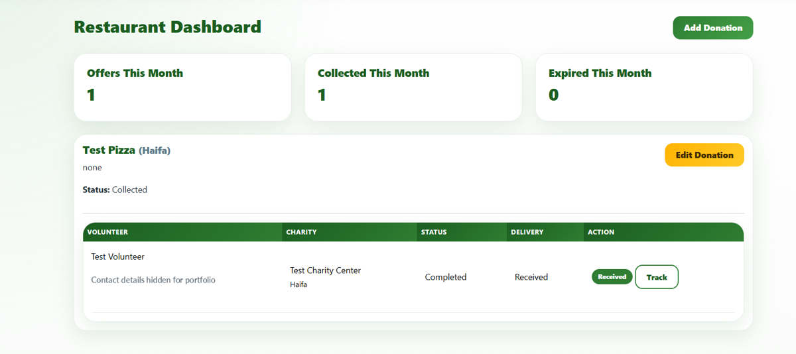
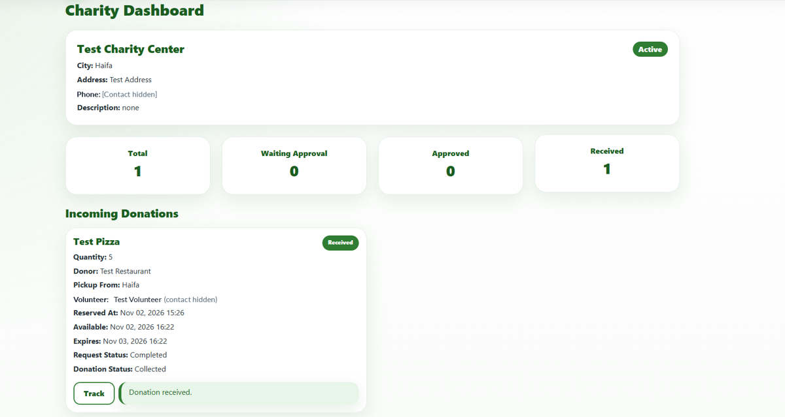

# ShareBite

**Food Donation Coordination Platform | Full-stack PHP & MySQL Project**

ShareBite is a role-based web application designed to help food donors, volunteers and charity centers coordinate surplus-food donations. It combines offer discovery, reservation requests, approval workflows, charity delivery confirmation and administrative reporting in one application.

**Portfolio status:** The core workflow has been verified on a clean local WampServer/MySQL installation. This curated repository is intentionally **Private** while publication rights, authorization tests and security issues are reviewed. **Live public demo: not deployed.**

## What problem does it solve?

Surplus food can be wasted while local charities need a reliable way to coordinate donations. ShareBite gives donors a way to list available food and lets volunteers arrange delivery to a selected charity center. Users can follow the status of each donation rather than relying entirely on informal messages.

## Main capabilities

| Role | Supported activities |
| --- | --- |
| **Donor / Restaurant** | Create and edit food offers, specify quantities, ingredients, allergens, location and expiry time, and approve or reject reservation requests |
| **Volunteer** | Browse and filter donations, save favorites, choose an active charity center and request offers, follow reservation/delivery status and leave reviews |
| **Charity Center** | See relevant deliveries and confirm that an approved donation has arrived |
| **Admin** | Manage users and charity centers, review messages and suggestions, monitor donations and view dashboard charts |

Additional functionality includes an interactive Leaflet map with OpenStreetMap, email notifications via PHPMailer, account registration and login, password-reset codes, and reports about donation problems.

## How the donation workflow works

1. A **Donor** publishes an available food offer.
2. A **Volunteer** selects the offer and the charity destination. The donation becomes `Pending`.
3. The **Donor** approves the request, moving the donation to `Claimed`, or rejects it so it can become available again.
4. The Donor can mark an approved offer as **picked up**. This does **not** mean the charity has received it.
5. The relevant **Charity Center** confirms delivery. The reservation becomes `Completed`, its delivery status becomes `Received`, and the donation is `Collected`.

Business state transitions and authorization checks are separated from presentation where practical, including shared guards and database transactions for key approval, pickup and receipt operations.

## Technology stack

| Layer | Tools and technologies |
| --- | --- |
| Backend | PHP, PDO, sessions |
| Database | MySQL 8 |
| Frontend | HTML, CSS, JavaScript, Bootstrap 5 |
| Interactive maps | Leaflet, OpenStreetMap |
| Dashboard charts | Chart.js |
| Email delivery | PHPMailer with SMTP |
| Local environment | WampServer (Apache, PHP, MySQL) |
| Version control and checks | GitHub, GitHub Actions, PHP syntax/unit checks |

## Verified functionality

**Locally tested on 2026-11-02:** The owner installed ShareBite in a separate `ShareBite_Fresh` directory using a newly created empty database loaded from `database/schema.sql`. They then successfully registered and logged in as **Volunteer, Donor and Charity**, created a donation, requested it, approved it as the Donor, and confirmed receipt as the Charity. The final reservation state was **Completed** with **Received** delivery status.

Other local tests on a separate `ShareBite_Test` database covered rejection, pickup versus receipt, failed-login throttling, image upload validation and problem reporting. These are owner-reported browser tests. GitHub Actions runs PHP syntax checks and focused automated tests; it is not a substitute for a complete security audit or production integration test.

[Manual test record](docs/testing.md) | [Security review and outstanding work](docs/security-review.md)

## Local development

**Requirements:** PHP with PDO MySQL, MySQL 8 and Apache/WampServer. The current `schema.sql` uses MySQL 8 collation settings; MariaDB compatibility has not been fully verified.

1. Clone or download the repository into an Apache-served directory.
2. Create a **new, empty** MySQL 8 database and import [`database/schema.sql`](database/schema.sql). Do not import it over existing application data.
3. Configure the database connection with `DB_HOST`, `DB_NAME`, `DB_USER` and `DB_PASSWORD` in the local environment, following [the database guide](database/README.md).
4. If email is needed, copy `mail_config.example.php` to a **local-only** `mail_config.php` and supply credentials. This file is excluded by `.gitignore`.
5. Start Apache and open the project's local URL (for example, `http://localhost/ShareBite/`).
6. Register disposable test accounts for the supported roles and follow the [test plan](docs/testing.md). No real user records or accounts are included in the SQL schema.

**Never** import `map_upgrade.sql` after the current structure-only SQL, because the coordinate fields are already present.

## Code organization

| File or folder | Responsibility |
| --- | --- |
| `index.php`, `offers.php`, `search_offers.php` | Offer browsing and filtering |
| `add_offer.php`, `edit_donation.php` | Food offer entry and editing |
| `claim_offer.php`, `donor_action.php` | Reservation requests and Donor decisions |
| `complete_pickup.php`, `confirm_delivery.php` | Pickup and verified Charity receipt |
| `donation_workflow.php`, `functions.php` | Shared state rules and application helpers |
| `donor_dashboard.php`, `charity_dashboard.php`, `admin_dashboard.php` | Role-specific dashboards |
| `map.php` | Food donation and charity location map |
| `database/schema.sql` | Current structure-only schema, without user rows |
| `tests/`, `.github/workflows/` | Automated checks |

## Demo screenshots

These screenshots were captured during a **local test** on a newly imported database with disposable Donor, Volunteer and Charity accounts. Contact details were hidden for this portfolio presentation.

### Donor / Restaurant Dashboard

### Charity Center Dashboard

The screenshots demonstrate a sample workflow, not production usage or real donation impact. This curated portfolio repository starts with a fresh Git history, and excludes unreviewed historical screenshots and sample food photographs. **Keep the portfolio Private until the remaining source, dependency and publication reviews are complete.**

## Portfolio and future plans

- [Recruiter-facing project summary and suggested CV wording](docs/portfolio.md)
- [Portfolio release and later production deployment plan](docs/release-roadmap.md)
- [Security review and unresolved risks](docs/security-review.md)
- [Portfolio-specific security and Public-release review](docs/portfolio-publication-review.md)
- [Third-party libraries, licenses and attributions](THIRD_PARTY_NOTICES.md)
- [Database setup and restrictions](database/README.md)

**Current scope:** educational full-stack portfolio project, locally tested. **Future scope:** production deployment only after a separate security, privacy, infrastructure and operations review. The repository is not yet approved for public release or live hosting.
